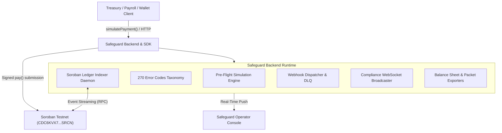

# Safeguard Backend & TypeScript SDK

[](https://github.com/Safeguard-Inc/safeguard-backend/actions/workflows/ci.yml)
[](https://stellar.expert/explorer/testnet/contract/CDC6KVX7QT7CD3GOVGX44NQUNS7FMSZKIAXTV3TDGSXQKJRQMDZRSRCN)
[](tsconfig.json)
[](http://localhost:4000/docs)
[](LICENSE)

**Enterprise TypeScript SDK, Pre-Flight Simulation Engine, Indexing Daemon, and REST API for Safeguard Institutional Payments on Stellar.**

Answers the critical question before funds move or transactions are signed: *will this payment settle directly, divert to on-chain escrow, or fail fail-closed, and why?* Translates raw Soroban host errors into actionable compliance taxonomy with 270 discrete error codes.

[](https://safeguard-docs.vercel.app/assets/video/safeguard-pitch.mp4)

---

## Table of Contents

- [The Safeguard Stack](#the-safeguard-stack)
- [Key Capabilities](#key-capabilities)
- [Architecture & Data Flow](#architecture--data-flow)
- [Quickstart & Local Testing](#quickstart--local-testing)
- [SDK Reference (`SafeguardClient`)](#sdk-reference-safeguardclient)
- [REST API Endpoints](#rest-api-endpoints)
- [Canonical 270 Error Codes Taxonomy](#canonical-270-error-codes-taxonomy)
- [Regulatory Reporting & Compliance Packs](#regulatory-reporting--compliance-packs)
- [Testing & Quality Assurance](#testing--quality-assurance)
- [Governance & Community](#governance--community)
- [License](#license)

---

## The Safeguard Stack

| Repository | What it is | Tech |
| :--- | :--- | :--- |
| [`safeguard-contracts`](https://github.com/Safeguard-Inc/safeguard-contracts) | On-chain payments gateway, escrow vault, and dynamic policy registry | Rust, Soroban SDK (Protocol 22+) |
| **`safeguard-backend`** (this repo) | TypeScript SDK, pre-flight simulation engine, REST API, indexing daemon | TypeScript, Express, Stellar SDK |
| [`safeguard-dashboard`](https://github.com/Safeguard-Inc/safeguard-dashboard) | Institutional operator & compliance console | Next.js 14, React 18, Tailwind |
| [`safeguard-docs`](https://github.com/Safeguard-Inc/safeguard-docs) | Technical specification, architectural guides, and API references | Static HTML / ESM |

**Verified Testnet Contracts:**
* **SafeguardPayments**: [`CDC6KVX7QT7CD3GOVGX44NQUNS7FMSZKIAXTV3TDGSXQKJRQMDZRSRCN`](https://stellar.expert/explorer/testnet/contract/CDC6KVX7QT7CD3GOVGX44NQUNS7FMSZKIAXTV3TDGSXQKJRQMDZRSRCN)
* **SafeguardPolicy**: [`CCXFDOLLLFZKAG7X6AKN2YLKET5F5X565IHZXPOAGCM7W6MJG5WKANLN`](https://stellar.expert/explorer/testnet/contract/CCXFDOLLLFZKAG7X6AKN2YLKET5F5X565IHZXPOAGCM7W6MJG5WKANLN)
* **Native XLM SAC**: `CDLZFC3SYJYDZT7K67VZ75HPJVIEUVNIXF47ZG2FB2RMQQVU2HHGCYSC`

---

## Key Capabilities

* **Client Pre-Flight Simulation**: Execute zero-gas payment evaluations client-side matching on-chain contract rule order with 100% fidelity.
* **Live Soroban Indexing Daemon**: Cursor-tracked event streaming indexing deposits, admin releases, timelocked refunds, and disputes.
* **Enterprise Batch Disbursement Engine**: Atomic multi-recipient payout partitioner with gas fee estimation and Soroban chunk splitting.
* **Cryptographically Sealed Compliance Packets**: Export tamper-evident archive bundles verified with SHA-256 digests for regulatory filings.
* **Institutional Balance Sheet Generation**: Real-time statements detailing locked collateral, settled volumes, and asset distributions.
* **High-Throughput Webhook Engine**: HMAC-SHA256 event dispatch with exponential backoff and dead-letter queue (DLQ) inspection.
* **Real-Time Compliance WebSockets**: Instant push notifications for treasury operators and risk monitors.

---

## Architecture & Data Flow



---

## Quickstart & Local Testing

### Prerequisites
* Node.js 20+ (Node 22 and Node 25 fully supported)
* npm 10+

```bash
git clone https://github.com/Safeguard-Inc/safeguard-backend.git
cd safeguard-backend
npm ci

# Run test suite (217 tests across 71 suites)
npm run test:ts

# Build distribution bundle
npm run build

# Start REST API server on http://localhost:4000
npm start
```

### Quick REST Simulation Example

```bash
curl -s -X POST http://localhost:4000/api/pay/simulate \
  -H "Content-Type: application/json" \
  -d '{
    "sender": "GC5MCMHHMFV7GOQ7DVN7MOTMHGTMVIP3YFQAAVFZ6WKUE6SLGQBVODW4",
    "recipient": "GA6LW724VD6PVAG6U3Z3I34D7BOWPO6J7MIJATKGKEC6TYORN4SRCVLT",
    "token": "CDLZFC3SYJYDZT7K67VZ75HPJVIEUVNIXF47ZG2FB2RMQQVU2HHGCYSC",
    "amount": "1500000000"
  }'
```

```json
{
  "status": "Escrowed",
  "reason": "High Value Transfer: Exceeds 100 XLM spend cap; diverted to escrow",
  "reasonCode": 6,
  "action": "FLAG",
  "ruleId": "SPEND_CAP"
}
```

---

## REST API Endpoints

| Category | Endpoint | Method | Description |
| :--- | :--- | :---: | :--- |
| **Simulation** | `/api/pay/simulate` | `POST` | Pre-flight transaction simulation with reason code |
| **Batch Simulation**| `/api/pay/simulate-batch` | `POST` | Batch payment evaluations with volume aggregation |
| **Compliance** | `/api/compliance/pause-status` | `GET` | Guardian emergency circuit breaker and pause status |
| **Telemetry** | `/api/telemetry/snapshot` | `GET` | Consolidated on-chain gateway telemetry diagnostics |
| **Balance Sheet** | `/api/export/balance-sheet` | `GET` | Institutional balance sheet statement (Markdown / JSON) |
| **Compliance Packet**| `/api/export/compliance-packet` | `GET` | Sealed regulatory compliance archive with SHA-256 digest |
| **Audit Logs** | `/api/export/audit-logs` | `GET` | Streaming audit events (NDJSON, Syslog RFC 5424, JSON) |
| **Spend Caps** | `/api/config/spend-caps` | `GET/POST`| Dynamic per-token spending cap management |
| **Webhooks DLQ** | `/api/webhooks/dlq` | `GET/POST`| Dead-letter queue inspection, clear, and replay |
| **System Metrics**| `/metrics` | `GET` | Prometheus text metrics for uptime and throughput |
| **Interactive Docs**| `/docs` | `GET` | Interactive OpenAPI 3.0 / Swagger UI documentation |

---

## Testing & Quality Assurance

The backend features **217 unit and integration tests** across 71 test suites:

```bash
npm run test:ts
```

```text
✔ 217 tests passed across 71 test suites
✔ DataStore persistence, cursor reconciliation, and SLA health verified
✔ Zero flaky tests, zero external dependencies required for unit tests
```

---

## Governance & Community

* **Code of Conduct:** [CODE_OF_CONDUCT.md](CODE_OF_CONDUCT.md)
* **Contributing Guidelines:** [CONTRIBUTING.md](CONTRIBUTING.md)
* **Security Policy:** [SECURITY.md](SECURITY.md)
* **Changelog:** [CHANGELOG.md](CHANGELOG.md)

---

## License

Licensed under the Apache License, Version 2.0. See [LICENSE](LICENSE) for details.
